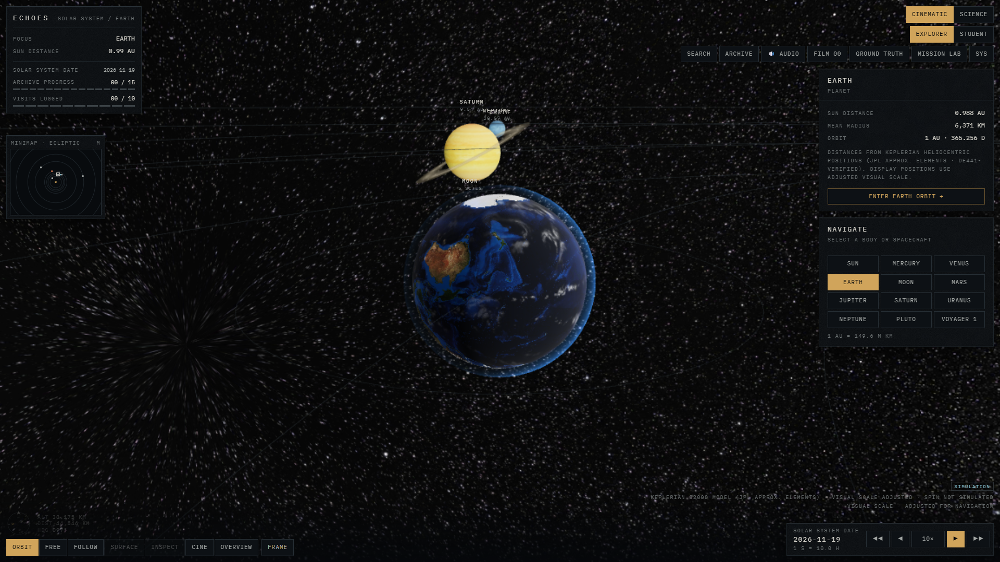

# ECHOES

**Every Journey Leaves a Trace.**

ECHOES is a browser-based 3D exploration experience that connects destinations in the solar system with the spacecraft sent to study them. Visitors can travel between planetary bodies, descend to selected mission sites, inspect spacecraft representations, and explore mission records containing timelines, discoveries, scientific context, and source references.

[](docs/images/hero-solar-system.png)

## Why ECHOES

Space exploration is often encountered as disconnected photographs, dates, and technical records. ECHOES brings the destination, the machine, and the mission record into one navigable environment so visitors can understand not only what a spacecraft was, but where it operated and what it helped humanity learn.

## Explore

- **Solar system navigation** — travel between selectable planetary bodies using the project's orbital and coordinate model. Displayed distances and body sizes are visually compressed for navigation and are identified as such.
- **Ten registered mission vehicles or spacecraft representations** — MER-A (Spirit), MER-B (Opportunity), Sojourner, InSight, Apollo 12, 14, 15, 16, 17, and Voyager 1.
- **Planetary mission sites** — Mars and lunar terrain informed by MOLA and LOLA elevation data, with mission-specific vehicle and site visualizations.
- **Mission records** — objectives, chronology, instruments, discoveries, operational status, and source-linked facts.
- **Mission journeys** — chapter-based experiences for registered missions. Opportunity (MER-B) additionally has a spatial waypoint route and an embedded 3D documentary.
- **Scientific context** — selected planetary, solar, orbital, and mission information presented with source and visualization-status labels.

The level of interactivity differs by mission. Opportunity is currently the only mission with a spatial waypoint route; the other mission journeys are chapter-based.

## How it works

| Layer | Implementation |
|---|---|
| Rendering | React, TypeScript, three.js and React Three Fiber |
| Solar system | JPL approximate Keplerian elements with documented visual scale compression |
| Planetary sites | MOLA (Mars) and LOLA (Moon) elevation data, plus mission-specific scene assets |
| Mission records | Structured mission data with source references and operational-status distinctions |
| Journeys | Chapter-based timeline experiences; Opportunity also includes a spatial route |
| Stability | Separate scientific, presentation, and render coordinate frames |

Official models, reconstructions, artistic visualizations, and archival media should be distinguished in the interface. A reconstructed model or visualization is not presented as a direct observation.

## Technology

React 19 · TypeScript · three.js · @react-three/fiber · Vite · Tailwind CSS · Zustand · Vitest · Playwright.

## NASA, JPL and other data sources

The application uses a combination of NASA/JPL/USGS resources and other credited materials, including NASA 3D Resources spacecraft geometry, MOLA and LOLA elevation data, JPL approximate Keplerian elements, NASA Solar Dynamics Observatory imagery and data products, NASA Image and Video Library mission media, NASA Science mission pages, the NSSDCA Master Catalog, and USGS planetary map products.

The exact source, classification, and attribution for individual assets and mission claims are maintained in the project's asset attribution and mission source records. NASA materials are not evidence of NASA endorsement.

## Run locally

```bash
npm install
npm run dev
```

Build and verify:

```bash
npm run build
npm test
npx tsc --noEmit
```

The production build is a static site and can be hosted on a static web server.

## Known limitations

- Nine of the ten mission journeys do not currently include archival imagery; those journeys are primarily text-led.
- Opportunity (MER-B) is currently the only mission with a spatial waypoint route.
- Planetary distances and body sizes are visually compressed for navigation; scientific readouts retain the corresponding values and labels.
- Axial tilt and spin are not rendered.
- Voyager 1's displayed live distance uses the project's propagation model, not a published real-time ephemeris.
- External archive/API availability can affect optional remote media retrieval; core mission records are maintained in the application.

## AI use

AI coding assistants were used to help write and refactor application code, verification scripts, and documentation. Factual claims are linked to their sources and should be checked against the cited primary material. The product's imagery, video, textures, and audio are described in the asset register and the separate AI-use disclosure.

## Credits and independence

ECHOES uses materials from NASA, JPL-Caltech, USGS, and other credited sources. ECHOES is an independent project and is **not affiliated with, endorsed by, or sponsored by NASA**.
