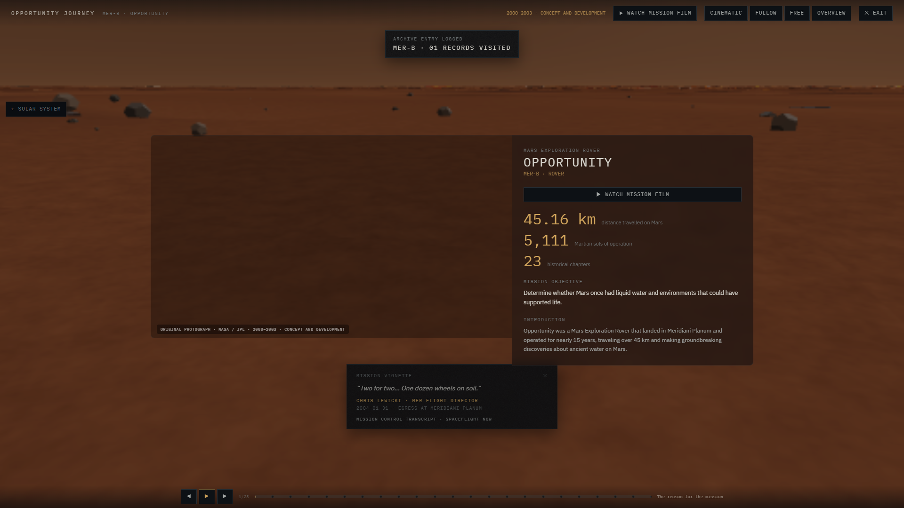
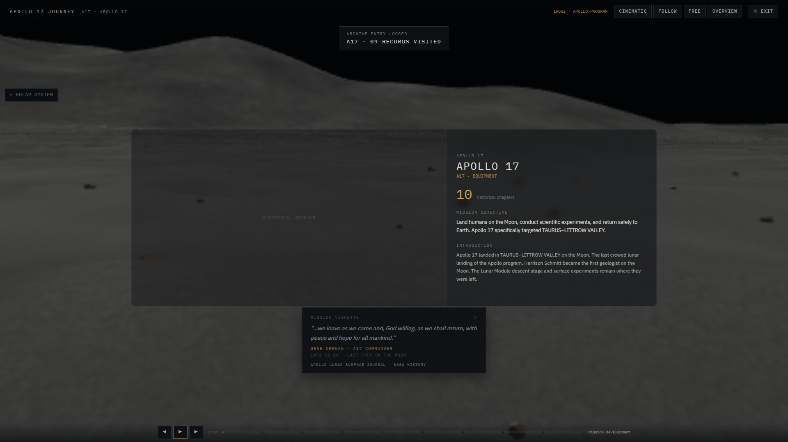

# ECHOES

**Every Journey Leaves a Trace.**

> Explore the worlds, machines, journeys and discoveries that expanded humanity's
> reach beyond Earth. Real missions. Real destinations. One continuous
> experience.

ECHOES is a real-time, explorable planetary system in the browser: fly the
solar system, drop to Mars and the Moon, walk up to the hardware that is still
sitting where it landed, and read the mission record of every machine the
archive holds — with the science, the dates and the imagery sourced from NASA,
JPL and USGS.

[](docs/images/hero-solar-system.png)

---

## The problem

Spaceflight history is usually told as a slideshow: a photograph, a paragraph,
a date. The machines are abstractions and the places they went are coordinates
on a map. What is missing is the **continuity** — the sense that a specific
vehicle, in a specific place, did specific things, and that the evidence still
exists.

## What ECHOES is

An interactive 3D exploration system where **the machines are in their real
locations** and **the record is attached to the place**:

- **A real solar system** — JPL Keplerian orbits, correct radii (visually
  compressed and labelled as such), and every body selectable and flyable.
- **Ten real spacecraft**, each standing on (or drifting in) its real
  destination: MER-A, MER-B, Sojourner, InSight, Apollo 12, 14, 15, 16, 17 and
  Voyager 1.
- **Real site terrain** — MOLA (Mars) and LOLA (Moon) digital elevation models
  at the landing sites, with the rover tracks, rock fields and landing hardware
  of the mission that flew there.
- **A documentary layer** — every mission has a journey: its chronology, its
  narrative, its milestones, its discoveries, its source-cited facts and its
  verified operational status.
- **The MER-B mission film** — Opportunity's complete 18-chapter documentary
  running as *code* inside the mission experience: procedural worlds, camera
  choreography, the archival NASA/JPL media, and the launch tape's original
  audio.

| Opportunity's site | Apollo 17's site | The solar system |
|---|---|---|
|  |  |  |

---

## How it works

| Layer | What it is |
|---|---|
| **Frame model** | Three coordinate layers that are never mixed: **SCI** (real units for every measurement), **PRESENT** (visually compressed, for rendering), **RENDER** (camera-relative, for GPU stability). |
| **Orbits** | JPL approximate Keplerian elements, DE441-verified; the Moon and Pluto use documented approximations and say so. |
| **Sites** | DEM-backed terrain, a rock/slab scatter graded by distance, the vehicle, the mission route with its waypoints, the arrival choreography. |
| **Missions** | One artifact per machine: dates, hardware with instrument explainers, science records, timeline, and an audited mission record with sources. |
| **Journeys** | A timeline state machine per mission — chapters, plates, narration, milestones, discoveries, camera shots. |
| **Navigation** | A director sequences every camera move; navigation *tickets* guarantee a slow, stale transition can never overwrite a newer user choice. |

---

## Implemented features

- Real-time solar system with focus, travel, descent and return-to-solar for
  every body.
- Ten spacecraft with modelled or officially-sourced geometry (the Mars
  Exploration Rovers use NASA's own published GLB).
- Per-site DEM terrain, lighting, shadows, beacon and site vignette.
- Mission journeys for all ten devices, with chapter navigation, a scrubbable
  timeline, case files and an inspect drawer.
- The MER-B (Opportunity) mission film — a full 3D documentary mounted inside
  the journey interface.
- Mission film registry: a device with a registered film shows
  **WATCH MISSION FILM**; every other device shows nothing at all.
- Audited mission facts with links to the primary sources, shown in every
  mission panel.
- Search, archive, science records, instrument panels, a session film roll,
  spatial ambience and a full keyboard control set.
- Production build locked to the **Ultra** tier; development diagnostics are a
  development-only chunk.

---

## Technology

React 19 · TypeScript · three.js r186 · @react-three/fiber 9 · Vite 7
(single-file production build) · Tailwind 4 · Zustand · Vitest · Playwright.

---

## NASA data and media sources

| Data | Source |
|---|---|
| Planetary imagery | NASA/JPL maps; USGS Viking MDIM 2.1 (Mars); NASA SVS CGI Moon Kit (LROC) |
| Earth imagery | NASA Blue Marble + Earth Observatory |
| Solar imagery | NASA SDO — HMI continuum and AIA 171/193/211/304 full disks |
| Corona structure | NASA LASCO C3 |
| Spacecraft geometry | NASA 3D Resources — `MER_static.glb` |
| Orbital elements | JPL approximate Keplerian elements |
| Mission media | NASA Image and Video Library; archive.org (MER-2003-1020 launch tape) |
| Star field | Gaia-derived catalogue compiled in-project |

Full register with licences and attribution:
[`ASSET_LICENSE_AND_ATTRIBUTION.md`](ASSET_LICENSE_AND_ATTRIBUTION.md) ·
per-mission claims: [`MISSION_SOURCE_REGISTER.md`](MISSION_SOURCE_REGISTER.md).

---

## Install & run

```bash
npm install
npm run dev        # http://localhost:5173
```

```bash
npm run build      # → dist/index.html (single file) + dist/films, dist/tex-hi
npm run preview    # serve the production build
```

```bash
npm test           # 172 unit tests
npx tsc --noEmit   # type check
```

The production build is a static site: `dist/` can be served by any static host.
A `dist/` deployment needs no server-side code and no credentials.

---

## Credits, rights and disclosures

| Document | What it covers |
|---|---|
| [`ASSET_LICENSE_AND_ATTRIBUTION.md`](ASSET_LICENSE_AND_ATTRIBUTION.md) | every planetary, spacecraft and media asset with its licence and credit |
| [`MISSION_SOURCE_REGISTER.md`](MISSION_SOURCE_REGISTER.md) | per-mission claims and their primary sources |
| [`NASA_DATA_AND_RESOURCES.md`](NASA_DATA_AND_RESOURCES.md) | the NASA data actually used by the application |
| [`SECURITY_AUDIT.md`](SECURITY_AUDIT.md) | secret scan, dependency and privacy review |
| [`AI_USE_DISCLOSURE.md`](AI_USE_DISCLOSURE.md) | complete, honest record of AI assistance |
| [`NASA_SPACE_APPS_SUBMISSION_PACKET.md`](NASA_SPACE_APPS_SUBMISSION_PACKET.md) | the competition submission record |

---

## AI use

AI coding assistants were used to write and refactor the application, the
verification scripts and the documentation. Every factual mission claim is
sourced, and the launch/landing/end dates were verified against NASA sources
during the release audit — three generated Apollo launch dates were found wrong
and corrected. **No AI-generated imagery, video, texture or audio is used in
the product.** The only non-observational visual is a human-made artist map,
explicitly labelled *ARTISTIC VISUALIZATION — NOT AN OBSERVATION (CC BY 4.0)*.

Full disclosure: [`AI_USE_DISCLOSURE.md`](AI_USE_DISCLOSURE.md).

---

## Limitations

- Nine of the ten journeys do not yet carry archival imagery (only MER-B does);
  those journeys are text-led rather than illustrated.
- Only Opportunity carries a spatial mission path with waypoints.
- Distances and body sizes are visually compressed for navigation; true values
  are always available in the readouts and are labelled.
- Axial tilt and spin are not rendered.
- Voyager 1's live distance uses the project's own propagation model, not a
  published ephemeris.

---

## Credits

Built with NASA and JPL-Caltech data and imagery, which are generally not
copyrighted; attribution is provided throughout the interface and in
[`ASSET_LICENSE_AND_ATTRIBUTION.md`](ASSET_LICENSE_AND_ATTRIBUTION.md).

ECHOES is **not** affiliated with, endorsed by, or sponsored by NASA.
